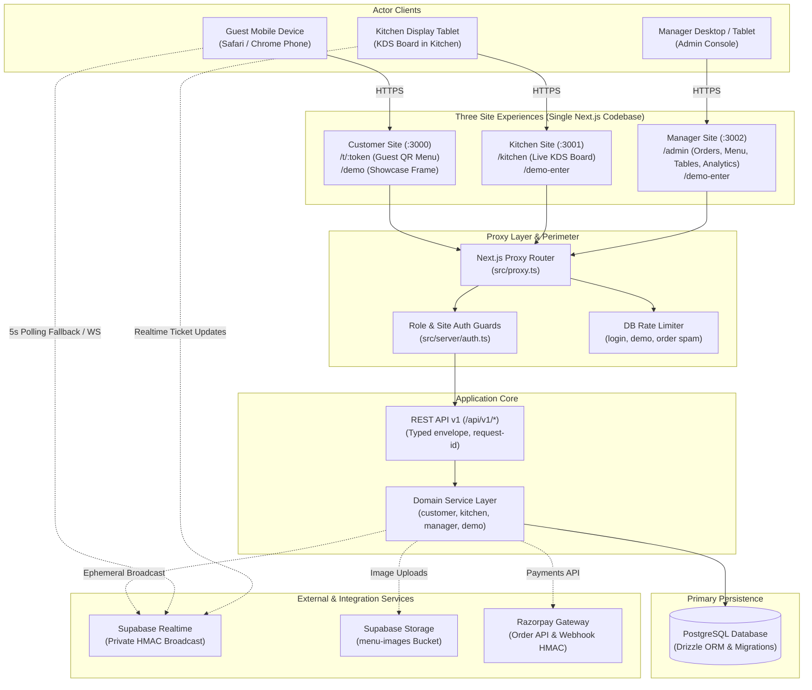
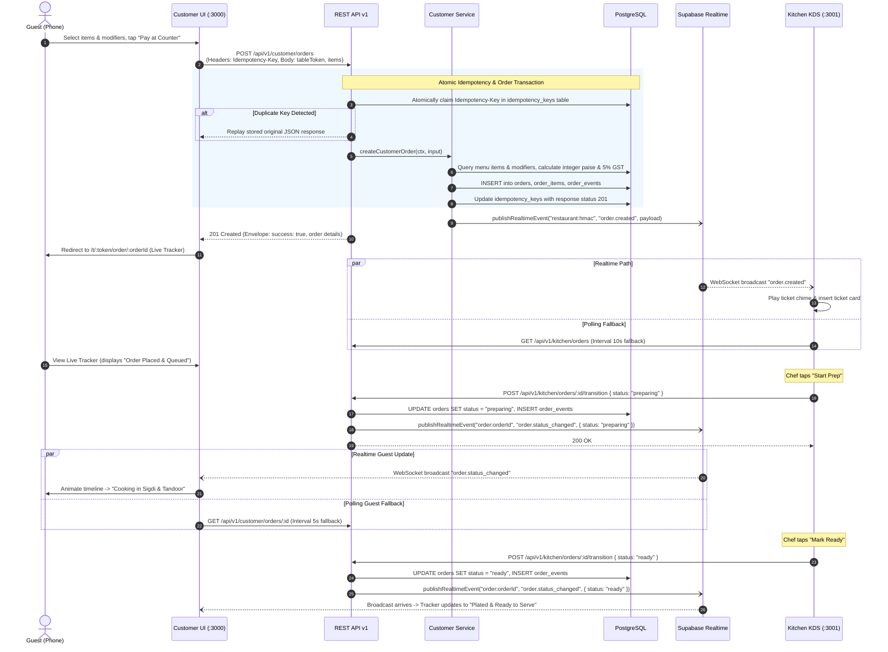

# DinePulse Architecture & Technical Design

This document details the system architecture, component boundaries, data flows, and security model of DinePulse, an operational multi-site restaurant ordering and kitchen display system created by [Intallo](https://www.intallo.in).

---

## 1. System Context & Component Architecture

DinePulse deploys three specialized digital experiences from a single Next.js codebase. The application enforces architectural separation between guest dining, kitchen fulfillment, and administrative management through server-side proxy route dispatching, separate session cookies, and dedicated service layers.

### Core Architecture Principles

1. **One Codebase, Strict Site Boundaries**: Next.js App Router runs with a site-specific personality defined by the `SITE` environment variable (`customer`, `kitchen`, or `manager`). The request proxy ([`src/proxy.ts`](../src/proxy.ts)) enforces absolute perimeter isolation—manager routes return 404 on the customer domain, and customer table tokens return 404 on the kitchen or manager domains.
2. **Layered Decoupling**: UI components never query the database directly. All mutations and queries pass through the domain service layer ([`src/server/services/`](../src/server/services/)), ensuring business rules (such as GST calculations and valid order status state machines) are centralized and unit-testable.
3. **Resilient Realtime**: Supabase Realtime operates purely as an ephemeral notification bus. State mutations are committed atomically to PostgreSQL first. If WebSockets stall or drop, both the guest tracker and kitchen display automatically fall back to 5-second polling.

### Interactive Showcase Architecture (`/demo`)

The `/demo` route provides a live concept preview designed for prospective operators. Rather than attempting to crowd three simultaneous full viewports onto a desktop screen—which would compress the multi-column kitchen KDS board and manager data tables below readable tap targets and minimum widths—`/demo` implements an ergonomic **dual-pane split layout**:
- **Guest Mobile Pane (Left, 5 cols)**: Persistent mobile phone mockup rendering the live guest QR menu and order tracker (`/t/demo-table-7`).
- **Operational Tablet Pane (Right, 7 cols)**: High-resolution tablet frame embedding the staff surface via `/demo-enter`, featuring an instant one-click toggle switcher between the **Kitchen Display System (KDS)** and the **Manager Administration Console**.

This approach mirrors real restaurant operations: guests order on handheld smartphones, while staff toggle between kitchen station fulfillment and manager floor oversight on dedicated tablets or desktop workstations.

---

## 2. Order Lifecycle Sequence

The primary end-to-end order workflow demonstrates strict idempotency, transactional database writes, optimistic concurrency, and dual notification paths (realtime broadcast + fallback polling).

---

## 3. Authentication & Multi-Site Isolation

DinePulse implements defense-in-depth security to ensure that staff authentication cannot cross boundaries and that guests cannot access internal operations.

```mermaid
flowchart TD
    subgraph RequestRouting["1. Proxy Route Decision (src/proxy.ts)"]
        IncomingReq["Incoming Request to Site Domain"] --> CheckSite{"Current SITE Env?"}
        
        CheckSite -->|customer| CustomerRules{"Path in Customer Allowlist?<br/>(/t/*, /demo, /api/v1/customer/*)"}
        CheckSite -->|kitchen| KitchenRules{"Path in Kitchen Allowlist?<br/>(/kitchen, /api/v1/kitchen/*, /api/v1/auth/*)"}
        CheckSite -->|manager| ManagerRules{"Path in Manager Allowlist?<br/>(/admin, /api/v1/admin/*, /api/v1/auth/*)"}

        CustomerRules -->|No| Reject404["Return 404 Not Found"]
        KitchenRules -->|No| Reject404
        ManagerRules -->|No| Reject404
        
        CustomerRules -->|Yes| AllowCustomer["Dispatch Customer Route"]
        KitchenRules -->|Yes| RewriteKitchen["Rewrite / to /kitchen & Proceed"]
        ManagerRules -->|Yes| RewriteManager["Rewrite / to /admin & Proceed"]
    end

    subgraph StaffAuth["2. Staff Session Security (src/server/auth.ts)"]
        StaffLogin["POST /api/v1/auth/login<br/>(username, password)"] --> RateCheck{"Failed Attempts < 5 in 15m?"}
        RateCheck -->|No| Lockout429["Return 429 Rate Limited (Lockout)"]
        RateCheck -->|Yes| BcryptCheck["Compare Bcrypt Hash<br/>(Constant-time dummy hash on missing user)"]
        
        BcryptCheck -->|Mismatch| LogFailed["Increment login_attempts table & Fail 401"]
        BcryptCheck -->|Valid| RoleGate{"User Role allowed for SITE?"}
        
        RoleGate -->|Denied| SiteMismatch["401 Role Denied for this Site"]
        RoleGate -->|Allowed| SignToken["Sign Session Token<br/>HMAC-SHA256(payload, SESSION_SECRET)"]
        
        SignToken --> IssueCookie["Issue HTTP-Only, SameSite=Lax Cookie<br/>Name: dinepulse_[site]_session<br/>Payload claim: aud = site"]
    end

    subgraph Verification["3. Session Verification on Request"]
        IncomingStaffReq["Authenticated Staff Request"] --> CookieInspect{"Check Site-Specific Cookie"}
        CookieInspect --> CheckSig{"Verify HMAC Signature & aud === SITE"}
        CheckSig -->|Invalid / Tampered| AuthFail["401 Unauthorized"]
        CheckSig -->|Valid| LoadSession["Populate StaffSession Context with Actor"]
    end
```

### Site Isolation Matrix

| Characteristic | Customer Site (`:3000`) | Kitchen Site (`:3001`) | Manager Site (`:3002`) |
|---|---|---|---|
| **Audience (`aud`)** | `customer` (public) | `kitchen` | `manager` |
| **Session Cookie** | None (ephemeral table token) | `dinepulse_kitchen_session` | `dinepulse_manager_session` |
| **Allowed Staff Roles** | None (public guest access) | `kitchen`, `manager`, `admin` | `manager`, `admin` |
| **Cross-Site Rejection** | Manager/Kitchen URLs return 404 | Manager URLs return 404 | Kitchen URLs return 404 |
| **Cookie Partitioning** | `SameSite=Lax`, `HttpOnly` | `SameSite=Lax`, `HttpOnly` | `SameSite=Lax`, `HttpOnly` |
| **Frame Security (CSP)** | `frame-ancestors 'self'` | Allowed under customer origin in demo mode | Allowed under customer origin in demo mode |

---

## 4. Key Architectural Decisions & Failure Handling

### Financial Calculation Precision (Integer Paise)
All prices, modifiers, discounts, taxes, and payments are stored and calculated exclusively as integer paise (`1 INR = 100 paise`). Floating-point mathematics (`0.1 + 0.2`) is strictly forbidden across the codebase.
- Menu items store `price_paise` (e.g., `28500` for ₹285.00).
- GST is computed on the server: `taxPaise = Math.round(subtotalPaise * 0.05)`.
- Razorpay order creation and webhook verification validate amounts against the database integer total.

### Realtime Broadcast Resilience
Supabase Realtime channels are derived with HMAC SHA-256: `restaurant:${HMAC(restaurantId, SESSION_SECRET).slice(0, 24)}`. This prevents unauthenticated users from guessing or listening to order streams.
- If WebSocket connections drop or fail to establish, the client automatically continues operating via its 5-second polling interval.
- Server-side event publishing includes a 1.5-second safety resolution timeout so that database mutations and HTTP responses are never blocked by external network latency.

### Timing-Safe Authentication & Brute-Force Protection
- User lookups in [`src/server/auth.ts`](../src/server/auth.ts) execute a constant-time comparison against a precomputed 10-round bcrypt hash when the requested username does not exist. This eliminates timing side-channels for user enumeration.
- Failed password attempts are tracked in the `login_attempts` PostgreSQL table. Five failed attempts within a 15-minute window lock out the username/IP combination with HTTP 429.

---

## 5. Further Documentation & Operational Guides

- **API Specification**: Refer to [`docs/API.md`](API.md) and the in-app interactive reference at `/api/v1/openapi.json`.
- **Testing & Verification**: Refer to [`docs/TESTING.md`](TESTING.md) for end-to-end test execution, unit test suites, and database safety rules.
- **Production Deployment**: Refer to [`docs/DEPLOY.md`](DEPLOY.md) for multi-project Vercel deployment, connection pooling configurations, and environment secrets.
