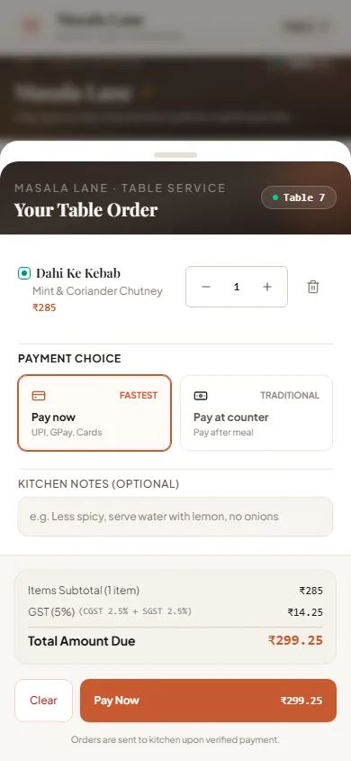
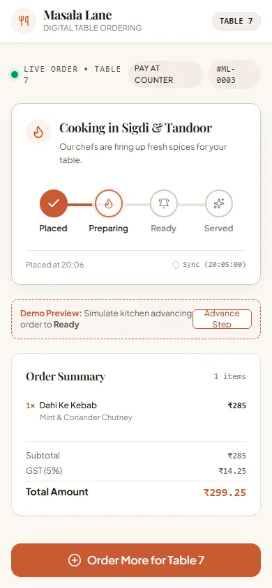
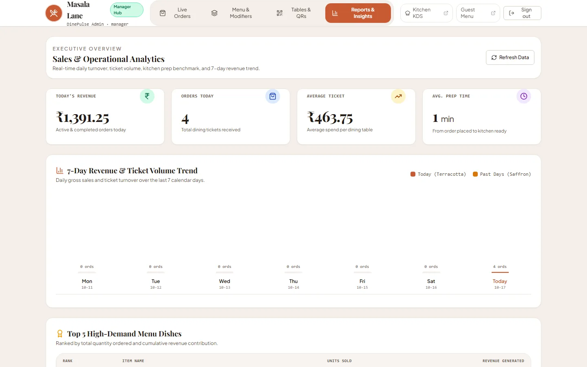

# Case Study: DinePulse — Real-Time Multi-Site Restaurant Operations

*Concept preview and portfolio engineering showcase by [Intallo](https://www.intallo.in).*

---

## Interactive Preview & Deployment Links

*Target deployment domains and demonstration media for this concept project:*

- **Customer Ordering Experience**: `{{LIVE_CUSTOMER_URL}}`
- **Kitchen Display System (KDS)**: `{{LIVE_KITCHEN_URL}}`
- **Manager Administration Console**: `{{LIVE_MANAGER_URL}}`
- **90-Second Walkthrough Video**: `{{DEMO_VIDEO_URL}}`

---

## 1. The Brief

Dine-in restaurants face an ongoing operational friction: paper menus slow table turnover, peak hours overwhelm waitstaff, and legacy POS terminals create fulfillment delays between dining rooms and kitchens.

Intallo designed **DinePulse** as an end-to-end concept for **Masala Lane**, a fictional contemporary Indian restaurant. The goal: replace manual ordering with a fast, zero-friction table flow while giving kitchen staff and managers instant operational synchronization.

Rather than building fragmented applications or requiring app downloads, Intallo architected DinePulse as a unified multi-site platform running from a single codebase.

---

## 2. The Three Experiences

DinePulse delivers three distinct surfaces, each built for the ergonomics of its specific environment.

### Guest Ordering (Mobile Phone)

Guests scan an unguessable QR token at their table to open a fast, mobile-optimized menu without downloading an app or creating an account.

Guests filter dishes by dietary preference (Vegetarian and Non-Veg indicators), customize spice levels and sides via detail sheets, inspect live cart subtotals, and choose between online payment or "Pay at Counter".

Once submitted, guests view an animated live order tracker. The tracker presents clear milestones from queueing to cooking in the tandoor to table dispatch.

### Kitchen Display System (Tablet / Station Screen)

Kitchen staff work in high-heat, fast-paced environments where touch targets must be prominent and screen distractions minimal.

The Kitchen Display System (KDS) renders chronological, color-coded tickets showing items, special modifiers, elapsed timers with clock-skew compensation, and one-tap status advancement controls (`Start Prep` → `Mark Ready` → `Served`). An ambient wake-lock ensures displays never sleep during kitchen shifts.

### Manager Administration Console (Desktop & Tablet)

Restaurant leadership requires operational visibility and catalog agility from any device.

The Manager Console provides four key operational modules:
- **Live Orders**: Real-time order monitoring with instant audit cancellation controls.
- **Menu Catalog**: Instant category and dish creation, availability toggles, and price editing.
- **Table Management**: Table layout management and generation of printable QR plaques with `%PDF` vector output.
- **Analytics & Reporting**: Daily gross sales, net revenue, tax distributions, average ticket sizes, and item volume metrics.

---

## 3. Key Decisions and Why

### One Codebase, Three Isolated Sites
Instead of maintaining three separate Next.js projects with duplicated business logic, DinePulse uses Next.js App Router configured via the `SITE` environment variable. The edge proxy ([`src/proxy.ts`](../src/proxy.ts)) enforces strict perimeter isolation: staff routes return 404 responses when accessed on the customer domain.

### Domain Service Layer & Consistent REST API v1
UI components never query the database directly. All mutations route through typed domain services ([`src/server/services/`](../src/server/services/)) returning a standard `ServiceResult<T>` envelope. API responses consistently format success payloads or structured errors with traceable request IDs.

### Atomic Idempotency Protection
Mobile network drops during checkout often cause guests to tap "Submit" multiple times. DinePulse implements atomic database-backed idempotency via the `Idempotency-Key` header. Duplicate requests replay the original response without creating duplicate tickets or charges.

### Strict Integer Paise Financial Calculations
Floating-point math introduces rounding errors that violate accounting standards. DinePulse stores and calculates all monetary values strictly as integer paise (`₹1.00 = 100 paise`), computing 5% Goods and Services Tax (GST) entirely on the server.

### Dual-Channel Realtime Resilience
Supabase Realtime provides instant WebSocket event broadcasting for kitchen and guest screens. Because restaurant networks can drop, the client treats realtime broadcasts as hints and maintains an automatic 5-second polling fallback.

---

## 4. Security and Reliability

DinePulse incorporates defense-in-depth engineering practices throughout:

- **Isolated Staff Session Cookies**: Staff authentication issues signed HMAC-SHA256 tokens in `HttpOnly`, `SameSite=Lax` cookies with an explicit audience (`aud`) claim. Kitchen tokens are rejected on the manager site.
- **Timing-Safe Login & Rate Limiting**: Authentication handlers compare missing usernames against a pre-computed dummy bcrypt hash to eliminate timing side-channels. A database-backed rate limiter locks accounts after 5 failed attempts within 15 minutes.
- **Payment Verification**: Webhook ingestion verifies Razorpay HMAC signatures and ensures the captured amount matches the database order total before marking payments complete.
- **Production Readiness Note**: While core perimeter guards, origin checks, and rate limits are fully implemented, commercial deployment would require an external security audit, hardware POS integration, and dedicated connection pooling.

---

## 5. Engineering Quality & Verification

System reliability is enforced through automated testing pipelines:

- **Unit & Integration Suite**: **306 passing tests** across **33 test files** via Vitest, validating calculations, rate limits, proxy routing, image resizing, and domain services.
- **End-to-End Suite**: **8 browser specifications** containing **11 Playwright tests**, exercising cross-site ordering, ticket progression, manager catalog updates, and PDF downloads against a real PostgreSQL database.
- **Continuous Integration**: **2 GitHub Actions CI jobs** (`verify` and `e2e`) validate every pull request with typechecking, linting, test suites, and production builds.
- **Accessibility & Mobile Compliance**: Mobile views are verified at 360px viewports with zero horizontal overflow, and Axe audits verify zero serious or critical accessibility violations across guest and staff surfaces.

---

## 6. Tech Stack

- **Framework**: Next.js 16 (App Router, Server Components, Edge Proxy)
- **Frontend & UI**: React 19, Tailwind CSS v4, Lucide Icons, Motion, Lenis
- **Database & ORM**: PostgreSQL with Drizzle ORM
- **Authentication**: Custom HMAC-SHA256 signed session cookies, bcrypt password hashing
- **Realtime**: Supabase Realtime (WebSocket broadcast with polling fallback)
- **Document Generation**: PDFKit vector rendering for table QR plaques
- **Testing**: Vitest, Playwright, @axe-core/playwright, @electric-sql/pglite

---

## 7. What I Would Do Next

If extending DinePulse for commercial deployment, key next steps include:

1. **Physical Kitchen Thermal Printer Integration**: Connect ESC/POS network receipt printers for automatic ticket printing at prep stations.
2. **Staff Role Granularity**: Introduce granular permissions (Host, Line Cook, Shift Manager) with quick PIN-based profile switching.
3. **Inventory Depletion Tracking**: Automatically decrement ingredient inventory as tickets advance to "Preparing", triggering out-of-stock badges on the guest menu when thresholds are reached.
4. **Offline PWA Capabilities**: Add service workers and background sync for kitchen display screens during network interruptions.

---

*DinePulse is an architectural concept and portfolio showcase by Intallo. Visit [intallo.in](https://www.intallo.in) to explore our bespoke web applications and automation solutions.*
